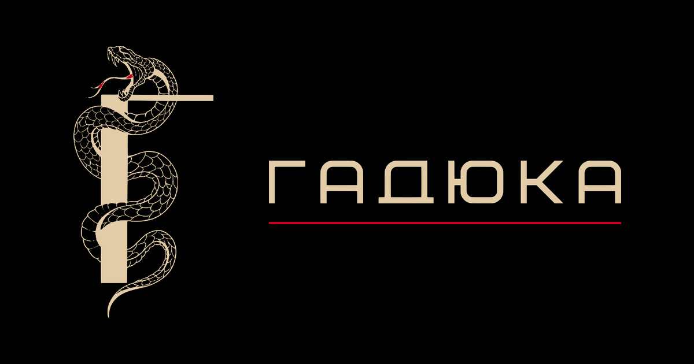
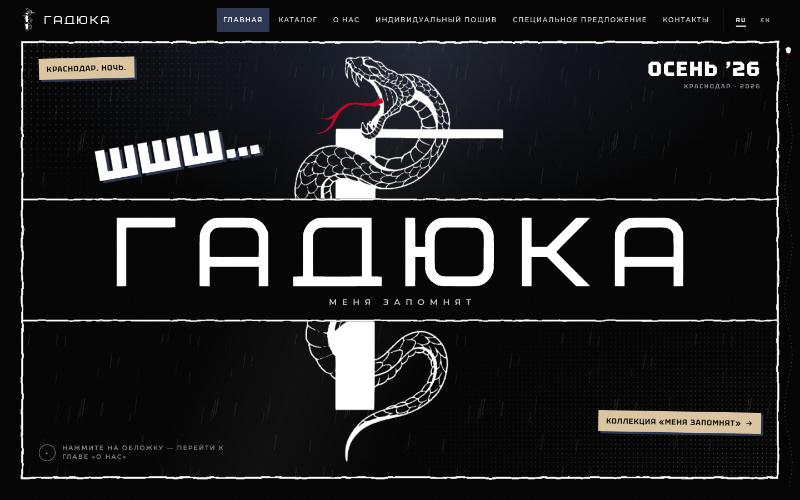
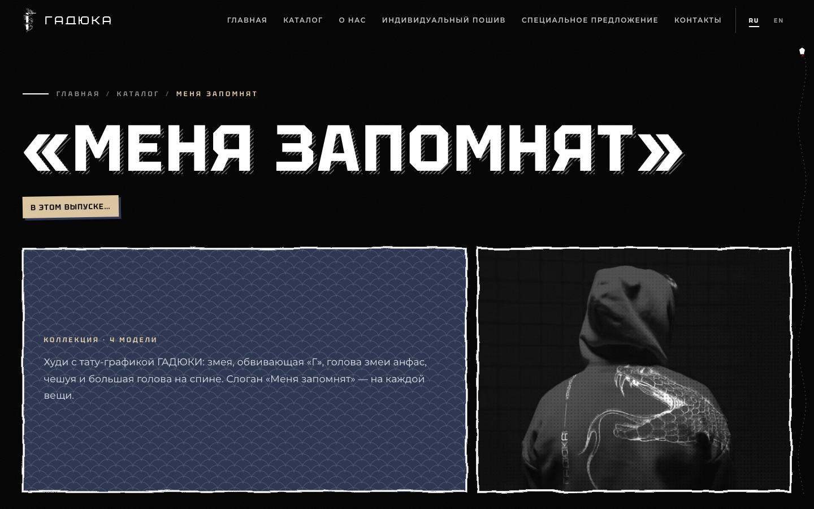
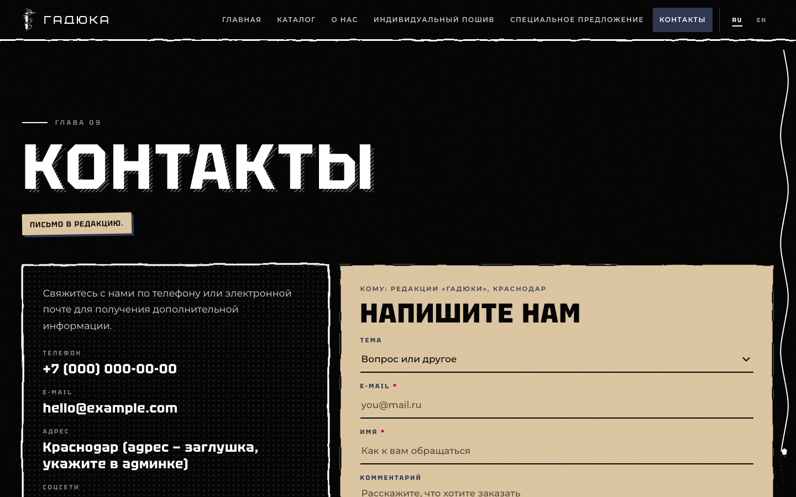
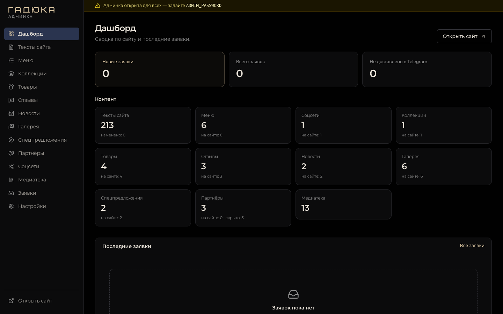

  

# ГАДЮКА

Сайт бренда уличной одежды из Краснодара: атмосферный лендинг, каталог коллекций, формы заявок и удобная админка для управления содержимым без правок кода.

## Главные возможности

- **Коллекции и товары** — публикация коллекций, просмотр моделей и фотографий каждого изделия.
- **Индивидуальный пошив** — заявка на создание вещи по пожеланиям клиента.
- **Новости, отзывы и спецпредложения** — актуальные материалы, оценки клиентов, галерея и партнёры бренда.
- **Формы связи с доставкой в Telegram** — заявки сохраняются в базе и отправляются владельцу сайта.
- **Два языка** — русская и английская версии сайта.
- **Фирменный дизайн** — адаптивная вёрстка, анимации и интерактивные элементы.

## Как выглядит

| Главная страница | Страница коллекции |
| --- | --- |
|  |  |
| **Контакты и форма заявки** | **Панель администратора** |
|  |  |

## Админка

Через раздел `/admin` можно:

- редактировать тексты на обоих языках, меню, контакты, соцсети и SEO-настройки;
- управлять коллекциями, товарами, отзывами, новостями, галереей, акциями и партнёрами;
- загружать изображения и использовать их повторно через медиатеку;
- просматривать заявки и контролировать их доставку в Telegram.

## Технологии

Next.js · React · TypeScript · NestJS · PostgreSQL · Prisma · MinIO · Docker

## Документация

Полная инструкция по установке, локальной разработке, настройке, деплою и резервному копированию — в [readme_dev.md](readme_dev.md).

Подробнее: [фронтенд](frontend/README.md) · [бэкенд](backend/README.md).
