# ГАДЮКА — сайт и админка

Лендинг бренда уличной одежды ГАДЮКА (Краснодар) со встроенной админкой.
Next.js 16 — только отображение — поверх NestJS-бэкенда `../backend` (данные, правила, валидация, картинки, заявки, вход) · next-intl (ru/en) · TypeScript strict · oxlint + oxfmt.
Тексты — `../shared/messages`, типы API — `../shared/contracts`.

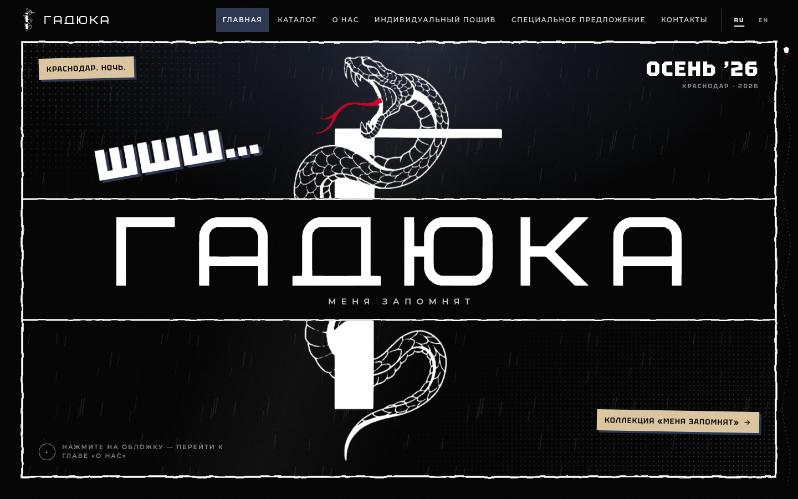

## Запуск локально

```bash
# 1. бэкенд (../backend/README.md): npm ci, .env, docker compose up -d, npm run prisma:deploy, npm run db:seed, npm run start:dev → :4000
cp .env.example .env    # BACKEND_URL=http://127.0.0.1:4000, INTERNAL_API_KEY = значение из backend/.env
npm install
npm run dev             # http://localhost:3000 (next dev; хост — localhost, не 127.0.0.1)
```

Вход в админку — логин и пароль админа бэкенда (`ADMIN_LOGIN` / `ADMIN_PASSWORD` в `backend/.env`, создаётся `npm run db:seed` бэкенда).

Проверки: `npm run typecheck`, `npm run lint`, `npm run format:check`, `npm test`, `npm run build` (бэкенд сборке не нужен: данные читаются только во время запроса).

## Куда идти

| Что                                    | Адрес                                                                  |
| -------------------------------------- | ---------------------------------------------------------------------- |
| Сайт (русский)                         | http://localhost:3000                                                  |
| Сайт (английский)                      | http://localhost:3000/en                                               |
| Страница коллекции                     | http://localhost:3000/catalog/menya-zapomnyat                          |
| Админка                                | http://localhost:3000/admin                                            |
| Тексты сайта                           | http://localhost:3000/admin/content                                    |
| Меню / соцсети                         | http://localhost:3000/admin/menu · http://localhost:3000/admin/socials |
| Настройки (контакты, SEO, шкала звёзд) | http://localhost:3000/admin/settings                                   |
| Медиатека                              | http://localhost:3000/admin/media                                      |
| API бэкенда (Swagger, только dev)      | http://127.0.0.1:4000/api/v1/swagger                                   |

Все страницы админки — только после входа (аккаунт бэкенда).

## Что где менять

- **Любой текст сайта** — админка «Тексты сайта». Значения по умолчанию лежат в `../shared/messages/ru.json` и `en.json`, сид бэкенда кладёт их в таблицу `Message`. Правки из админки сид не перезаписывает.
- **Телефон, e-mail, адрес, SEO, шкала звёзд отзывов** — «Настройки».
- **Пункты меню** (шапка и подвал) — «Меню». **Ссылки на соцсети и мессенджеры** — «Соцсети».
- **Коллекции, товары, отзывы, новости, галерея, спецпредложения, партнёры** — одноимённые разделы. Новая коллекция появляется на сайте сразу после публикации.
- **Картинки** — «Медиатека». Файлы хранит бэкенд в MinIO по ключу `admin/<id>/<uuid>/image.webp`, ссылка `/media/…` — в таблице `Media`.
- **Интерфейс админки** — `../shared/messages/admin/ru.json`. **Демо-контент сида** — `../shared/messages/content/*.json`.
- **Новая функция** (эндпоинт + экран) — контракт `../shared/contracts` → usecase бэкенда → вызов здесь: `../shared/contracts/README.md`.

Как добавлять новый текст в код — `../.claude/skills/site-texts/SKILL.md`. Правила для агентов — `AGENTS.md`.

## Скриншоты

|                                                          |                                                          |
| -------------------------------------------------------- | -------------------------------------------------------- |
| 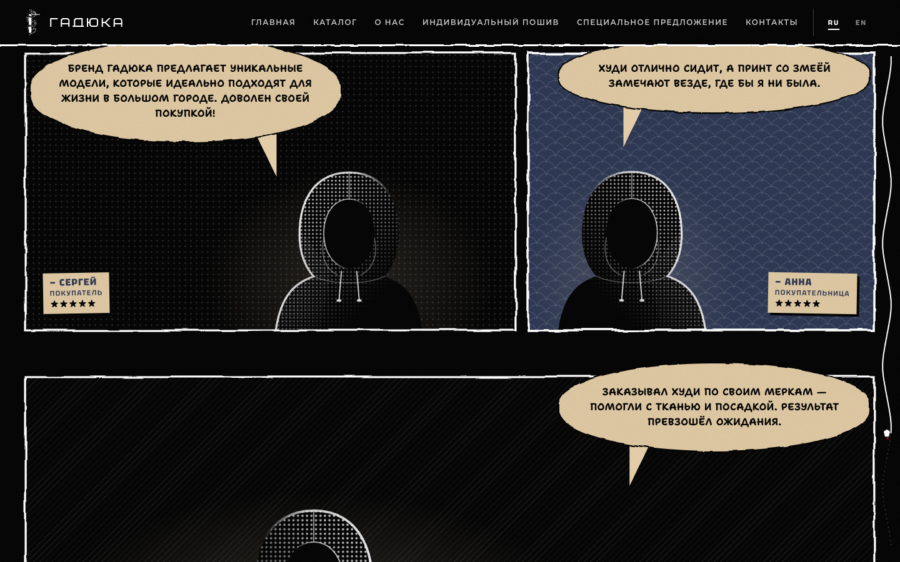 | 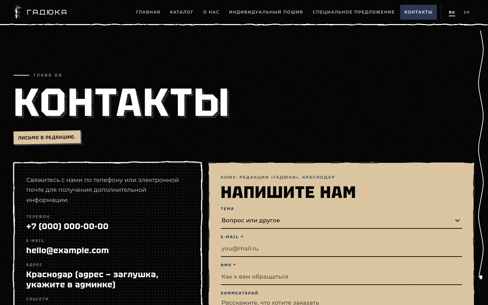  |
| 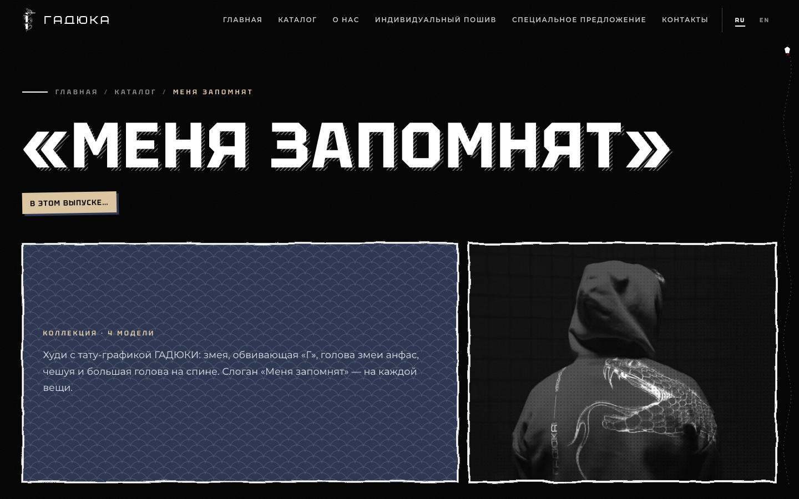 | 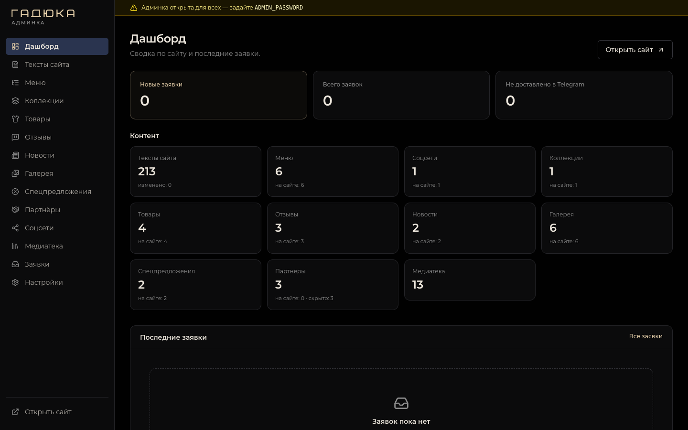         |
| 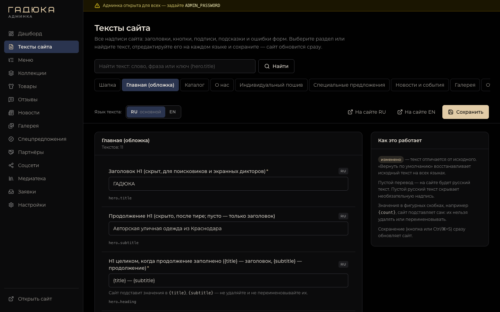        | 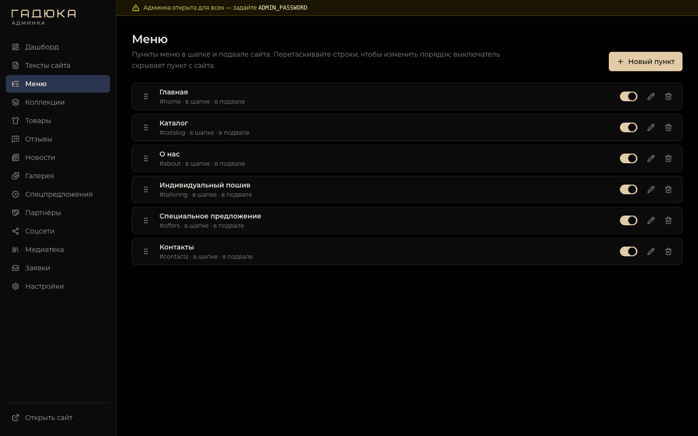                 |
| 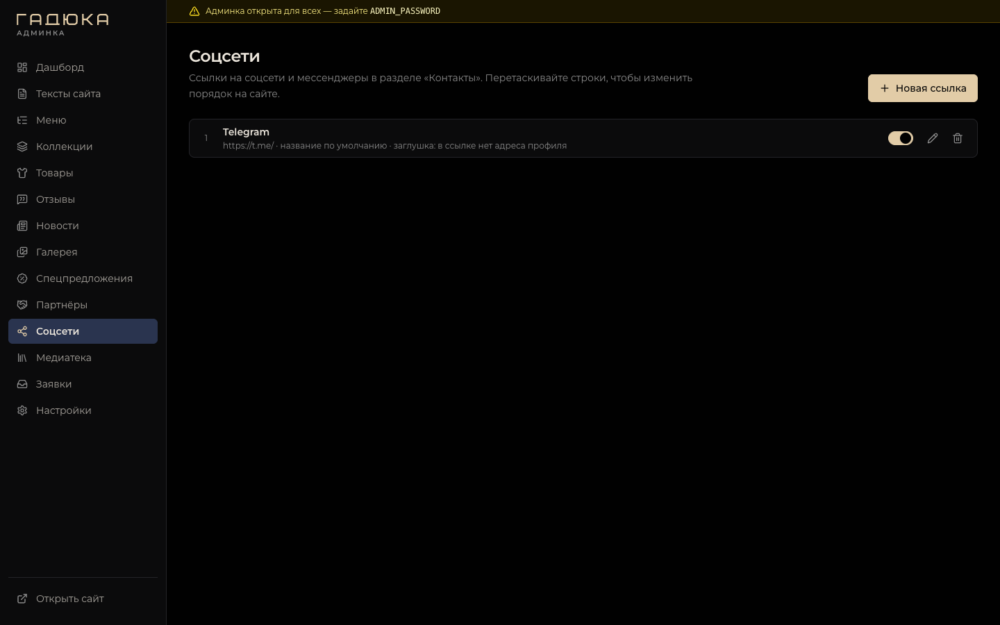           | 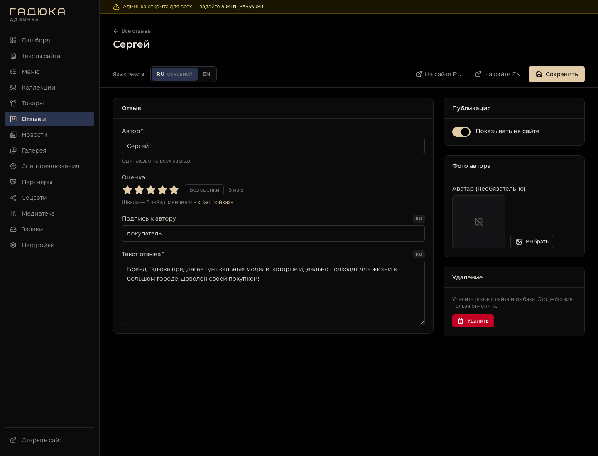 |
| 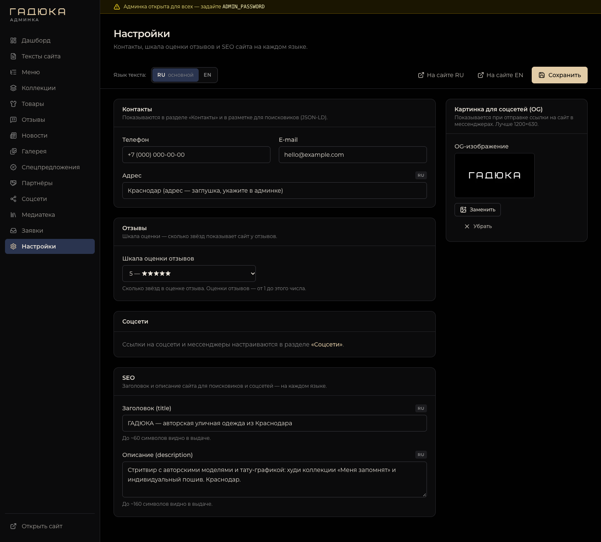        | 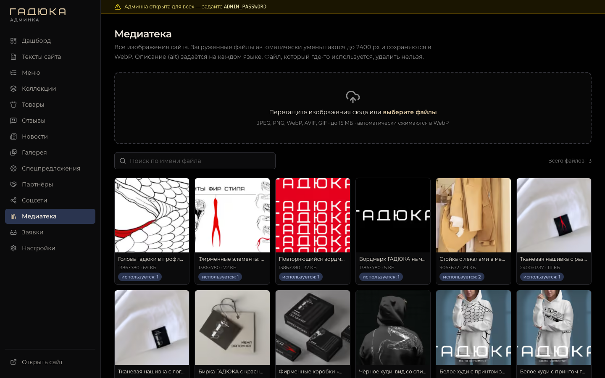           |

## Документация

- `docs/ARCHITECTURE.md` — что во фронтенде и что в бэкенде, тексты, картинки, админка, данные во время запроса.
- `docs/CONVENTIONS.md` — соглашения по коду (дизайн, анимации, кэш, заявки, доступ к админке …).
- `docs/COMPRESSION.md` — сжатие: предсжатые `.br/.zst/.gz` после сборки и что должен делать прокси (+ `/media`, IP посетителя).
- `src/lib/api/README.md` — клиент бэкенда: публичные чтения, чтения и действия админки, сессия.
- `../backend/README.md` — бэкенд: API, окружение, сид, тесты.
- `BRIEF.md` — бриф и исходные тексты.
- Деплой (корневой docker-compose, Caddy / nginx) — корневой `readme_dev.md` репозитория.
